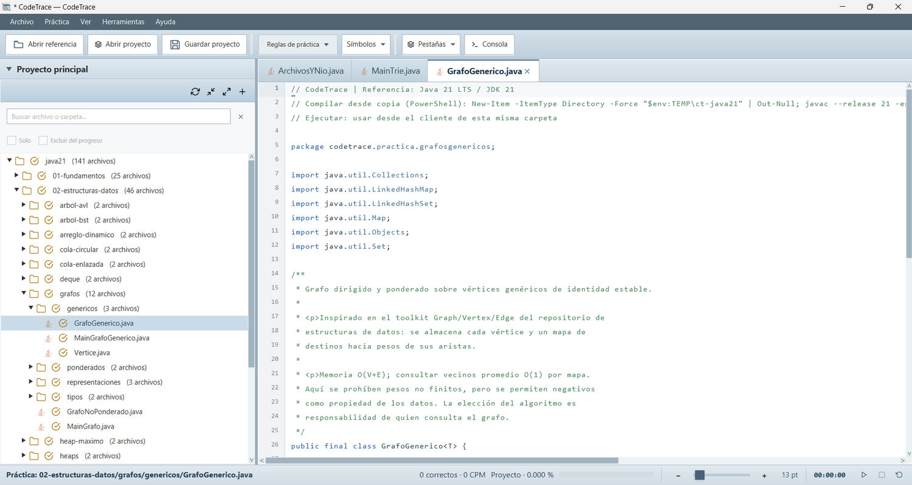
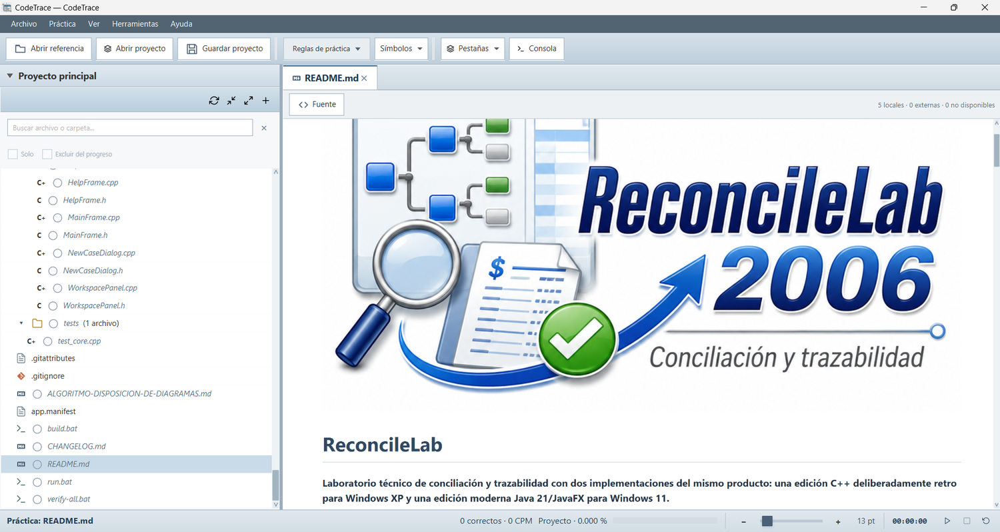
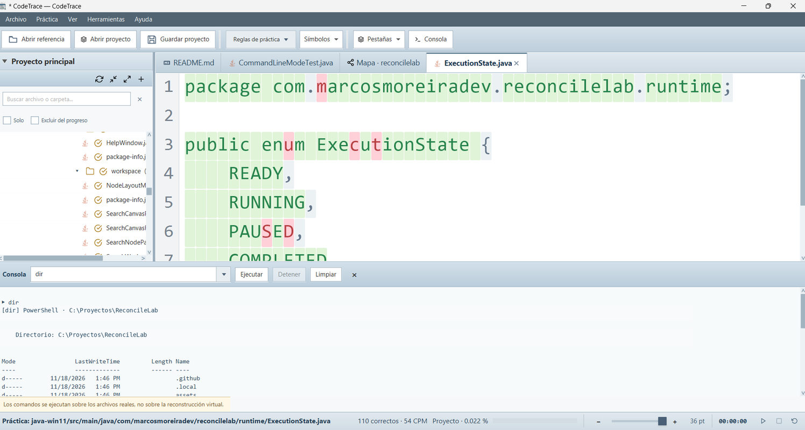

<div align="center">

# CodeTrace

### Aprende código reconstruyéndolo. Explora proyectos sin alterar sus originales.

**Un espacio de práctica de mecanografía para código real, con explorador, lectura, progreso y mapa de dependencias.**

Java 21 · JavaFX · Windows 11 · 14 lenguajes en la biblioteca de práctica · [Licencia MIT](LICENSE)

[Qué puedes hacer](#qué-puedes-hacer) · [Capturas](#capturas-de-pantalla) · [Instalación](#instalación-y-primeros-pasos) · [Desarrollo](#desarrollo) · [Estado del proyecto](#estado-del-proyecto)

</div>



> **Lee el código. Reconstruye su estructura. Escríbelo con precisión.** CodeTrace no pretende sustituir tu editor o tu IDE. Está pensado para estudiar la organización de programas y practicar su escritura, sin modificar los archivos que sirven de referencia.

## Qué puedes hacer

- **Practicar sobre una plantilla real.** Los caracteres de referencia permanecen visibles mientras escribes: los aciertos, errores y caracteres pendientes tienen estados diferenciados. Puedes seleccionar líneas, ajustar el tamaño de letra y usar un modo de concentración.
- **Reconstruir un proyecto de manera virtual.** Reproduce su estructura de carpetas y archivos, manualmente o mediante reglas automáticas, sin escribir encima de la referencia original.
- **Seguir el progreso.** Consulta el avance por archivo y proyecto; filtra carpetas y categorías, registra aciertos y velocidad, y guarda sesiones `.ctrace` para retomarlas más adelante.
- **Explorar proyectos existentes.** Navega el árbol de archivos, busca contenido y consulta código o archivos de configuración de solo lectura. La navegación está optimizada para proyectos grandes.
- **Comprender dependencias.** Visualiza relaciones estáticas entre archivos de una carpeta, acerca, desplaza y abre nodos desde el mapa. El análisis es aproximado: no sustituye a un compilador o analizador semántico.
- **Estudiar recursos complementarios.** Abre README con Markdown renderizado e imágenes locales; consulta imágenes, audio y vídeo compatibles, y utiliza una consola para ejecutar **comandos explícitos** sobre el proyecto real.

## Capturas de pantalla

### Aprende con una biblioteca organizada


La biblioteca integrada comprende **14 lenguajes y 813 archivos de referencia** en la candidata v0.3. Son *archivos*, no 813 ejercicios independientes. Sus contenidos cubren fundamentos, estructuras de datos, algoritmos y patrones de diseño; los ejemplos incluyen guías de consola y salidas esperadas, algunas todavía pendientes de validación cruzada en todos los entornos.

### Consulta documentación directamente dentro del proyecto



### Descubre cómo se relacionan los archivos


### Practica de forma visual y revisa tus errores


### Ejecuta comandos de forma consciente



**Nota de seguridad:** la consola trabaja sobre los archivos **reales de la carpeta de referencia**, no sobre el espacio virtual. Ejecuta únicamente comandos que conozcas, preferiblemente en una copia de prueba.

## Instalación y primeros pasos

**Plataforma principal:** Windows 11.

**Descargas oficiales:** [CodeTrace v0.3.0 — Windows](https://github.com/marcos-moreira-dev/CodeTrace/releases/tag/v0.3.0).

- **Instalador `.exe`:** instalación normal y asociación de sesiones `.ctrace`.
- **Archivo `.zip` portable:** descomprime y ejecuta `CodeTrace.exe` sin instalar Java por separado.
- **SHA-256:** se publica junto a ambos archivos para verificar sus descargas.

Esta primera publicación es una **versión de prueba**. El instalador no tiene firma digital; Windows puede mostrar advertencias de SmartScreen. Se han realizado pruebas automatizadas y uso real del autor, pero no una certificación exhaustiva en todos los equipos. Consulta [los límites y las pruebas](docs/CIERRE-V0.3.md).

Para probar el código fuente necesitas **Eclipse Temurin JDK 21**, **Maven** y un entorno gráfico de Windows:

```powershell
git clone https://github.com/marcos-moreira-dev/CodeTrace.git
cd CodeTrace
.\scripts\diagnostico.bat
```

El diagnóstico ejecuta las pruebas, abre la interfaz y produce un paquete de retroalimentación. Los scripts de compilación y empaquetado están documentados en [scripts/README.md](scripts/README.md).

## Desarrollo

**Stack:** Java 21, JavaFX 21, Maven, JUnit 5 y `jpackage` para Windows. El proyecto distingue los archivos fuente de referencia del estado de reconstrucción virtual y conserva sesiones de trabajo en archivos propios.

- [Guía de arquitectura y Javadoc](docs/GUIA-DE-ARQUITECTURA-CODETRACE.md)
- [Contrato de producto](docs/PRODUCTO.md)
- [Versiones y comandos de la biblioteca](docs/LENGUAJES-Y-COMANDOS.md)
- [Pruebas de aceptación Windows](docs/QA-WINDOWS.md)
- [Condiciones para publicación](docs/CIERRE-V0.3.md)

Para compilar y verificar, en el entorno configurado:

```powershell
mvn -B verify
```

Para generar un ZIP portable, y opcionalmente el instalador con las herramientas necesarias:

```powershell
.\scripts\package-windows.ps1 -Installer
```

**FFmpeg no se redistribuye por defecto.** Cuando está instalado y CodeTrace lo detecta, puede facilitar la vista previa local de formatos que JavaFX no soporta directamente; sus avisos y condiciones de redistribución deben verificarse antes de incluirlo en un instalador.

## Estado del proyecto

**CodeTrace v0.3.0 — primera versión pública de prueba.** El autor verificó informalmente las funciones habituales y el repositorio realiza pruebas automatizadas; no se afirma aceptación exhaustiva en todos los equipos Windows. La biblioteca contiene 813 archivos de referencia en 14 lenguajes, con anotaciones de consola. Algunas salidas de otros lenguajes se infirieron a partir del código y requieren comprobación en su entorno específico.

**Código fuente original:** licencia [MIT](LICENSE), © 2026 Marcos Moreira. Puedes usarlo, modificarlo y distribuirlo, incluso comercialmente, conservando el aviso y la licencia; no debes mostrar ningún contacto personal. Los elementos gráficos originales y los componentes de terceros tienen alcances distintos: [identidad y recursos](LICENSING.md) y [avisos de terceros](THIRD-PARTY-NOTICES.md). El nombre CodeTrace no se declara marca registrada.

---

<div align="center">

**CodeTrace** — una forma más deliberada de aprender cómo se construye el software.

Desarrollado por Marcos Moreira DEV.

</div>